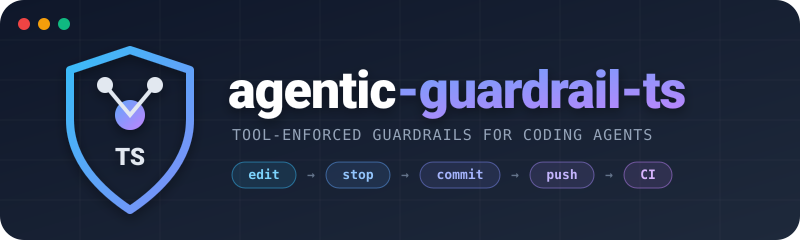
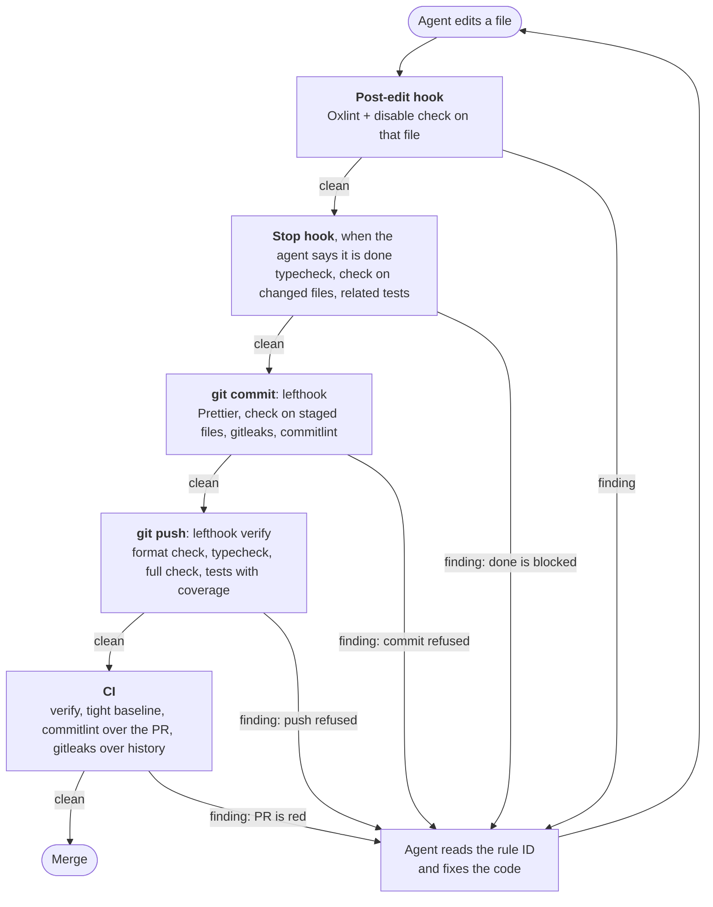

<p align="center">
  
</p>

<p align="center">
  <a href="https://github.com/Avinava/agentic-guardrail-ts/actions"></a>
  <a href="https://github.com/Avinava/agentic-guardrail-ts/blob/main/LICENSE"></a>
  <a href="https://github.com/Avinava/agentic-guardrail-ts"></a>
</p>

<p align="center">
  <strong>Tool-enforced guardrails for AI coding agents in TypeScript projects.</strong>
</p>

Agent skills that set up a lint, architecture, dead-code, test and secret gate in your TypeScript project, then wire that gate into the agent's own edit loop, your git hooks and CI.

## Why

Coding agents are fast and confident. They also leak `any`, forget to `await`, import across layers, and leave dead exports behind. Instructions in a prompt file help, but they are suggestions. A rule only holds when a tool checks it and refuses the change.

This repo gives your agent the skills to install those tools in your project and to respond correctly when one of them says no.

## Install

**Any agent: paste this into the chat.** It works in Claude Code, Codex, Gemini CLI, Cursor and any agent that can run shell commands.

```text
Set up guardrails in this project. Run `npx skills add Avinava/agentic-guardrail-ts -y`,
then read .agents/skills/setup-guardrails/SKILL.md in full and follow it.
```

**Claude Code plugin** (skills available in every project):

```text
/plugin marketplace add Avinava/agentic-guardrail-ts
/plugin install agentic-guardrail-ts@agentic-guardrail-ts
```

Then ask "set up guardrails". Either way the agent audits the project, shows a gap report, waits for your go-ahead, applies the changes and verifies them. See [Getting started](docs/getting-started.md) for the other install options.

## What gets installed

| Tool | Config | What it enforces |
| --- | --- | --- |
| Oxlint + oxlint-tsgolint | `.oxlintrc.json` | Type-aware lint: `no-explicit-any`, `no-floating-promises`, `no-unsafe-*`, size and complexity limits |
| TypeScript 7 (`tsc`) | `tsconfig.json` | Strict typecheck. `typescript` is aliased to TS 6 for tools that need its API |
| dependency-cruiser | `.dependency-cruiser.mjs` | Layers (single package) or tiers (monorepo), cycles, phantom deps |
| Knip 6 | `knip.json` | Unused files, exports and dependencies |
| Vitest 5 | `vitest.config.ts` | Tests and coverage floors that only go up |
| Prettier 3.9 | `.prettierrc.json` | Formatting |
| lefthook 2 | `lefthook.yml` | Git hooks: format, check, gitleaks, commitlint, `verify` |
| gitleaks | (binary) | Secrets in staged changes and history |
| commitlint | `commitlint.config.mjs` | Conventional commit messages |
| turbo 2, syncpack 15 | `turbo.json`, `.syncpackrc.json` | Monorepo only: task graph and one version per dependency |
| `scripts/guardrails.mjs` | `guardrails.baseline.json` | One entry point for the gate, the ratchet and agent hooks |
| Agent files | `AGENTS.md`, `CLAUDE.md`, `.claude/settings.json`, `.codex/hooks.json` | Agent rules and edit/stop hooks |
| CI | `.github/workflows/ci.yml` | The same gate as `git push`, plus a full-history secret scan |

Full details: [Tool reference](docs/tool-reference.md).

## Packs

The engine is language-agnostic. Each stack is a pack of tools that switch on when their config file exists, so nothing below changes an existing install. See [Packs](docs/packs.md) for the contract, and `node scripts/guardrails.mjs packs` to see what a repo has.

| Pack | Detect rule | Tools | Default |
| --- | --- | --- | --- |
| `ts` | `package.json`, `tsconfig*.json` | Oxlint, dependency-cruiser, Knip, Prettier, Vitest floors | on |
| `core` | every repo | cspell, jscpd, ast-grep, ls-lint, markdownlint-cli2, lychee, editorconfig-checker, actionlint | opt-in |
| `python` | `pyproject.toml`, `uv.lock` | ruff (lint, format), pyright, tach, deptry, vulture, pytest coverage floor | opt-in |
| `mule` | `mule-artifact.json`, `src/main/mule/*.xml` | mule-lint, Mule XML format check, properties secrets, MUnit through Maven | opt-in |
| `salesforce` | `sfdx-project.json`, `*.cls`, `*.trigger` | Code Analyzer (PMD, ESLint, retire-js), prettier-apex, metadata checks, Apex coverage floor | opt-in |

## How the loop works



Each layer catches what the one before missed. The agent sees the rule ID and file in every rejection and fixes the code. See [Agent loop](docs/agent-loop.md).

## The ratchet

Every rule is an error. There are no warn-only rules and no `--max-warnings`.

On an existing codebase, `node scripts/guardrails.mjs baseline --init` records today's findings in `guardrails.baseline.json`, counted per tool, rule and file (`oxlint:eslint(max-params)|src/billing/invoice.ts`). The gate then fails only when a count goes up. When you fix old findings, `baseline --tighten` locks the improvement in and raises Vitest coverage thresholds to what was measured. CI fails if the baseline is looser than the code.

Agents may not edit the baseline, run `--init` or `--reset`, or bypass hooks. See [Retrofit](docs/retrofit.md).

## Skills

Each skill lives in `skills/<name>/SKILL.md`.

| Skill | Use it when |
| --- | --- |
| `setup-guardrails` | Adding guardrails to a new or existing project. Audit first, then apply, then verify |
| `guardrails-loop` | Installing `AGENTS.md` and agent hooks, and responding to a rejection |
| `enforce-architecture` | Adding imports, reviewing tier or layer violations, changing the tier map |
| `adding-a-package` | Creating a workspace package in a monorepo |
| `guardrails-doctor` | Checking a project for drift from the templates and planning upgrades |

## Requirements

- Node 22.12 or newer (templates pin Node 24 in `.nvmrc`)
- A git repository
- npm, pnpm, Yarn (1 or Berry with `node_modules`) or Bun. See [Package managers](docs/package-managers.md)
- gitleaks installed on your machine (the npm package of that name is not official)

## Docs

| Guide | What it covers |
| --- | --- |
| [Getting started](docs/getting-started.md) | Install, first run, daily commands |
| [Tool reference](docs/tool-reference.md) | Every tool, its config and when it runs |
| [Agent loop](docs/agent-loop.md) | Hooks, rejections and how agents should respond |
| [Retrofit](docs/retrofit.md) | Adopting the gate on an existing codebase |
| [Migrating from v2](docs/migrating-from-v2.md) | Moving off ESLint, husky and lint-staged |
| [Monorepo setup](docs/monorepo-setup.md) | Workspaces, turbo, the `source` condition |
| [Architecture tiers](docs/architecture-tiers.md) | Designing layers and tiers |
| [CI pipeline](docs/ci-pipeline.md) | The GitHub Actions workflow |
| [Package managers](docs/package-managers.md) | npm, pnpm (with catalogs), Yarn, Bun |
| [Known conflicts](docs/known-conflicts.md) | Tool interactions to know about |
| [Troubleshooting](docs/troubleshooting.md) | Common failures and fixes |
| [Engine decision](docs/decisions/0001-engine.md) | Why Oxlint, TS 7 and dependency-cruiser |

## How this repo is tested

`templates/` is the single source for every config. `scripts/fixture-test.mjs` applies the templates to fixture projects in `test/fixtures/` (a single npm package, a pnpm monorepo, a Yarn 1 retrofit), installs them, and proves the gate passes clean code, catches seeded violations, ratchets, and drives the agent hooks and git hooks. This repo's CI runs the fixtures on every change.

## Contributing

See [CONTRIBUTING.md](CONTRIBUTING.md) and the [changelog](CHANGELOG.md).

## License

[MIT](LICENSE)
